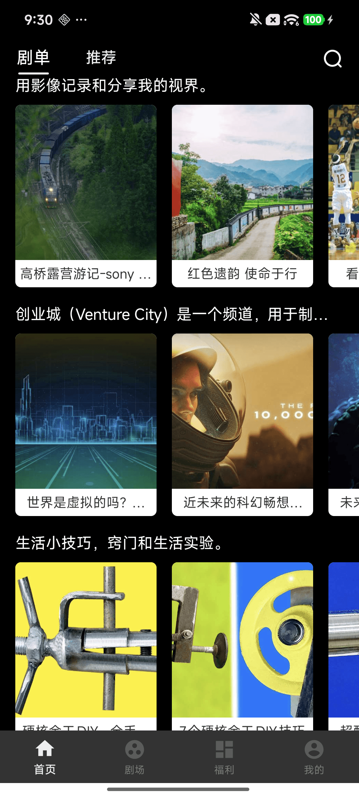
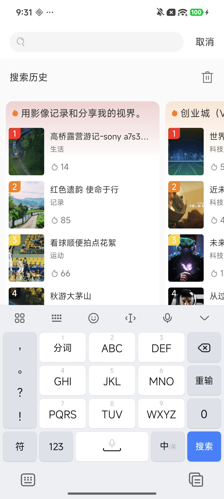
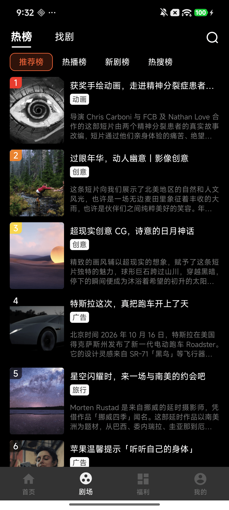
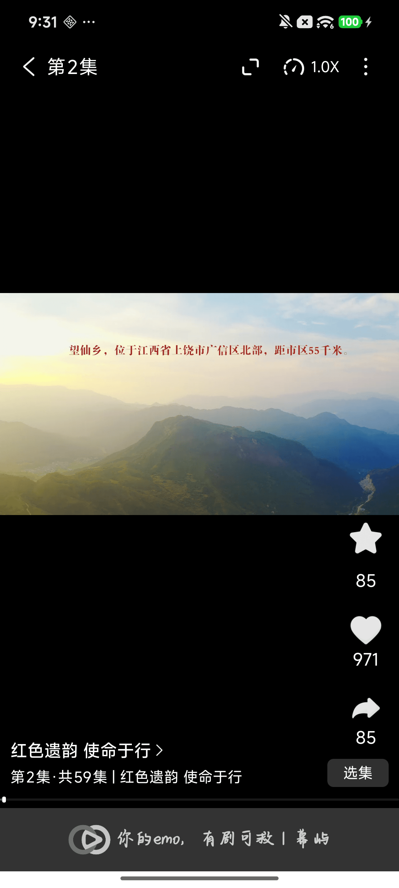
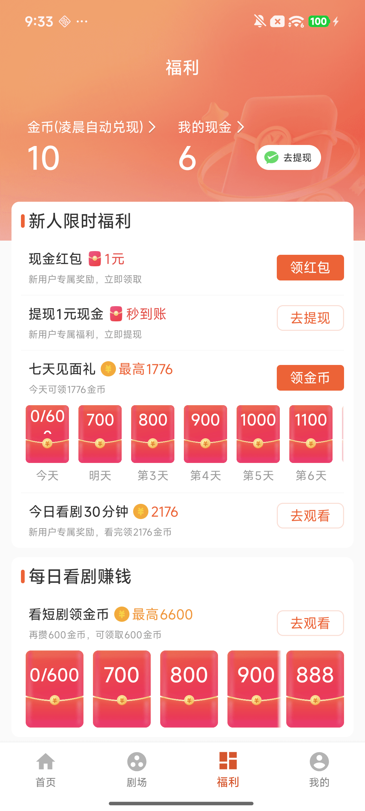
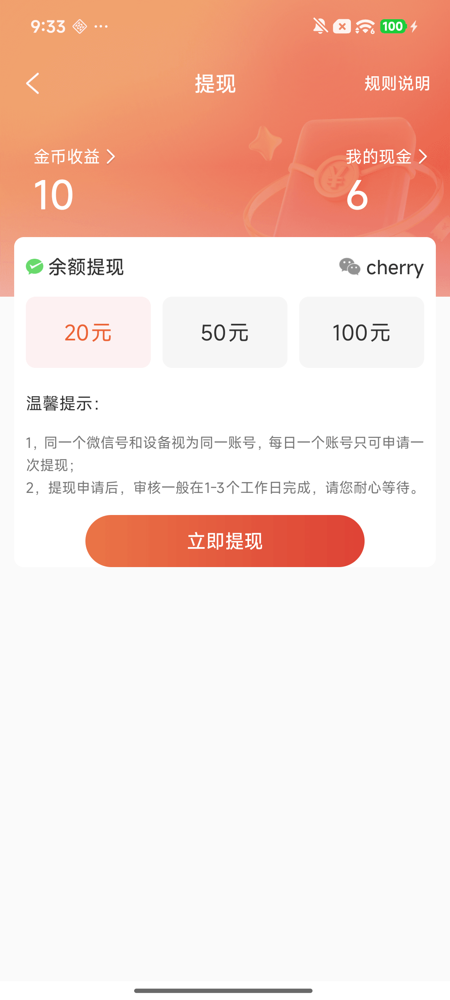
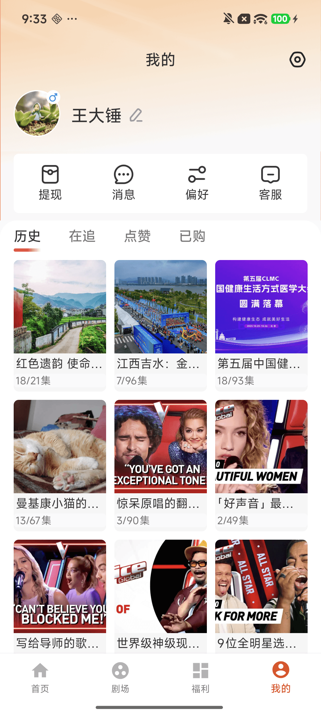

# Playlet 项目文档

> [!WARNING]
> **本项目仅供学习与技术交流使用，严禁任何形式的商业用途。**
>
> - 项目中涉及的网络接口均来自 **开眼视频（Eyepetizer）** 的公开测试接口（`baobab.kaiyanapp.com`），接口地址、音视频内容及相关数据版权均归开眼视频及其权利人所有。
> - 本项目不存储、不生产、不分发任何音视频内容，所有内容均通过上述接口实时获取，仅用于验证 Android 客户端技术方案的学习演示。
> - 请勿将本项目用于商业运营、内容分发、应用市场上架等盈利或违规场景，由此产生的一切法律与经济责任由使用者自行承担。

## 目录

- [免责声明](#免责声明)
- [一、项目概述](#一项目概述)
  - [下载体验](#下载体验)
  - [应用截图](#应用截图)
  - [技术栈](#技术栈)
- [二、项目架构](#二项目架构)
  - [架构图](#架构图)
  - [架构分层说明](#架构分层说明)
- [三、编译环境准备](#三编译环境准备)
  - [3.1 基础环境](#31-基础环境)
  - [3.2 编译并运行](#32-编译并运行)
- [四、模块说明](#四模块说明)
  - [4.1 应用壳](#41-应用壳)
  - [4.2 基础库](#42-基础库)
  - [4.3 业务模块](#43-业务模块)
- [五、构建与分发](#五构建与分发)
  - [5.1 build-logic 构建体系](#51-build-logic-构建体系)
  - [5.2 一键编译分发（推荐）](#52-一键编译分发推荐)
  - [5.3 Gradle 命令方式](#53-gradle-命令方式)
  - [5.4 手动分发（IDE 打包场景）](#54-手动分发ide-打包场景)
  - [5.5 编译产物目录](#55-编译产物目录)
  - [5.6 360 加固配置](#56-360-加固配置)
  - [5.7 分发脚本与辅助文件](#57-分发脚本与辅助文件)
- [六、开发指南](#六开发指南)
  - [6.1 组件化开发模式切换](#61-组件化开发模式切换)
  - [6.2 新 Module 创建模板](#62-新-module-创建模板)
  - [6.3 UI 开发规范](#63-ui-开发规范)
  - [6.4 网络请求使用流程](#64-网络请求使用流程)
  - [6.5 路由使用](#65-路由使用)
- [七、构建性能优化](#七构建性能优化)
- [八、相关文档索引](#八相关文档索引)

---

## 免责声明

- **使用范围**：本项目为个人学习 Android 组件化架构、MVVM 与视频播放方案的练手 Demo，仅限学习、研究与技术交流，**禁止任何形式的商业使用**。
- **接口归属**：项目中的网络接口源于 **开眼视频（Eyepetizer）** 公开测试接口，接口及内容版权归原平台所有，本项目仅作为接口调用示例，无任何商业合作或官方关联。
- **数据责任**：项目不存储、不缓存、不分发接口返回的音视频与数据，若接口失效、变更或被关闭，项目不再保证功能可用。
- **使用风险**：使用者应自行确认使用行为符合当地法律法规与接口提供方的服务条款，因使用本项目（尤其是商业使用）引发的一切后果由使用者自行承担，作者不承担任何连带责任。

> 若上述内容与您的权益存在冲突，请联系作者，本项目将立即删除相关代码或内容。

---

## 一、项目概述

> **Playlet 幕屿** · 每一幕都是心屿

**Playlet 幕屿** 是一款 Android 短剧应用，**每一幕都是心屿**。产品围绕剧集浏览、视频播放与个人中心等核心场景展开，以「幕」为内容单元、「屿」为情感落点，为观众提供沉浸式的追剧体验。

项目采用 **MVVM + NRouter 路由** 的组件化开发架构，使用 **Kotlin** 作为主要开发语言，通过 **build-logic Gradle Convention Plugin** 共享构建逻辑，并借助 **Version Catalog（libs.versions.toml）** 统一管理整个项目的依赖版本，兼顾多模块协作效率与独立调试能力。

### 下载体验

> 📲 **下载地址**：[https://www.pgyer.com/playet](https://www.pgyer.com/playet)（蒲公英测试分发平台，支持扫码或直接下载安装体验）

### 应用截图

| 首页 · 推荐流 | 首页 · 剧单 | 搜索 · 分组热榜 |
| :---: | :---: | :---: |
|  |  |  |
| 推荐信息流：沉浸式剧集卡片，支持收藏、点赞、分享与「免费看全集」 | 剧单分类：按主题聚合的剧集瀑布流，横向滑动查看更多 | 搜索页：搜索历史、分类排行榜与关键词搜索入口 |

| 剧场 · 热榜 | 剧场 · 找剧 | 播放 · 剧集详情 |
| :---: | :---: | :---: |
|  |  |  |
| 剧场热榜：推荐榜 / 热播榜 / 新剧榜 / 热搜榜多维度排行 | 找剧：甜宠、逆袭、热血、脑洞、反转等题材筛选 | 播放页：竖屏沉浸式播放，支持选集、倍速、收藏与分享 |

| 福利 · 金币任务 | 福利 · 提现 | 我的 · 个人中心 |
| :---: | :---: | :---: |
|  |  |  |
| 福利中心：金币收益、新人限时福利与「每日看剧赚钱」任务 | 提现页：微信余额提现、可选金额与到账规则说明 | 个人中心：提现 / 消息 / 偏好 / 客服入口与历史、在追、点赞、已购 |

### 技术栈

| 类别 | 技术 | 版本 |
|------|------|------|
| 语言 | Kotlin | 2.1.10 |
| 构建工具 | AGP (Android Gradle Plugin) | 8.9.1 |
| 编译环境 | JDK | 21 |
| IDE | Android Studio | Quail 3 (2026.1.3) |
| 架构模式 | MVVM + NRouter | - |
| 注解处理 | KSP | 2.1.10-1.0.31 |
| 数据库 | Room | 2.6.1 |
| 网络请求 | Retrofit + OkHttp3 | 2.9.0 / 4.2.0 |
| 图片加载 | Glide | 4.11.0 |
| 视频播放 | ExoPlayer | 2.19.1 |
| 动画 | Lottie | 5.2.0 |
| 推送 | 友盟 + 厂商推送 | - |
| 崩溃监控 | Bugly | latest |
| 微信 SDK | wechat-sdk-android | 6.7.9 |
| 二维码 | ZXing | 3.5.0 |
| 图片选择 | PictureSelector | v3.11.2 |

---

## 二、项目架构

### 架构图

```
┌──────────────────────────────────────────────┐
│                  应用层 (app)                  │
│              整个 App 的壳工程                  │
│       MainActivity + ViewPager + 底部导航       │
├──────────────────────┬───────────────────────┤
│      业务层           │                       │
│  module_home (首页)   │                       │
│  module_theater       │                       │
│  (剧场)               │                       │
│  module_welfare       │                       │
│  (福利)               │                       │
│  module_me            │                       │
│  (我的)               │                       │
├──────────────────────┴───────────────────────┤
│              基础层                             │
│  lib_common (widget/util/base/view)           │
│  NRouter 路由 / LiveDataBus 事件总线            │
├──────────────────────────────────────────────┤
│                  数据层                        │
│  lib_coremodel                               │
│  (api / datasource / service / vm /          │
│   Room DB / entity / repository)             │
├──────────────────────────────────────────────┤
│                共享配置层                       │
│  build-logic (Convention Plugin)             │
│  Version Catalog (libs.versions.toml)        │
└──────────────────────────────────────────────┘
```

### 架构分层说明

项目采用经典的组件化分层架构，从下至上分为以下层次：

| 层次 | 模块 | 说明 |
|------|------|------|
| **共享配置层** | `build-logic` | Convention Plugin + Version Catalog，统一管理构建逻辑和依赖版本 |
| **数据层** | `lib_coremodel` | 核心数据层，包含 API 接口、DataSource、Service、ViewModel、Room 数据库、Entity 等 |
| **基础层** | `lib_common` | 公共库，包含 Base 类、UI 组件、自定义控件、工具类、事件总线等 |
| **业务层** | `module_home` / `module_theater` / `module_welfare` / `module_me` | 各业务功能模块，支持独立运行和集成编译 |
| **应用层** | `app` | 应用壳工程，组件化编译时依赖 lib_common，集成编译时引入所有业务模块 |

---

## 三、编译环境准备

### 3.1 基础环境

1. 确保已安装 **Android Studio Quail 3 (2026.1.3)** 和 **JDK 21**
2. 配置 `local.properties` 中的 Android SDK 路径
3. 确保网络可访问 Google Maven 和 Maven Central 仓库

### 3.2 编译并运行

1. 使用 Android Studio 打开项目根目录
2. 等待 Gradle 同步完成
3. 选择目标设备（模拟器或真机）
4. 选择 Build Variant（如 `devDebug`、`_testDebug`、`betaDebug`、`onlineRelease` 等）
5. 点击 Run 运行

或通过命令行编译：

```bash
# 编译测试环境 Debug 版本
./gradlew assemble_TestDebug

# 编译 Beta 环境 Debug 版本
./gradlew assembleBetaDebug

# 编译线上环境 Release 版本
./gradlew assembleOnlineRelease
```

---

## 四、模块说明

### 4.1 应用壳

| 模块 | 说明 |
|------|------|
| **app** | 应用壳工程，组件化编译时依赖 lib_common，集成编译时引入所有业务模块。包含 MainActivity（底部导航 + ViewPager 架构） |

### 4.2 基础库

| 模块 | 说明 |
|------|------|
| **lib_common** | 公共基础库，包含 Base 类（BaseActivity / BaseFragment）、自定义控件（banner、expandablelayout、videowebview 等）、工具类、事件、接口定义、Adapter 等。依赖 lib_coremodel |
| **lib_coremodel** | 核心数据层，负责 MVVM 中的 Model 和 ViewModel。包含：API 接口定义、DataSource、Service、ViewModel + Factory、Room 数据库（DAO / Entity / Repository）、网络请求实体（bean / request / response）等 |

### 4.3 业务模块

| 模块 | 说明 |
|------|------|
| **module_home** | 首页功能模块，包含首页 Fragment、Activity、Adapter、ViewHolder 等 |
| **module_theater** | 剧场模块，包含剧场浏览、播放等功能 |
| **module_welfare** | 福利模块，包含福利相关功能 |
| **module_me** | 个人中心模块，包含个人信息、设置等功能 |

> 所有业务模块均支持在 **application** 和 **library** 之间切换。组件化编译时可作为独立 App 运行，集成编译时作为模块被 app 壳工程依赖。每个业务模块内部遵循 `view`（activity / fragment / adapter / holder / dialog）分层结构。

---

## 五、构建与分发

### 5.1 build-logic 构建体系

项目使用 **Gradle Convention Plugin** 来统一管理构建逻辑，所有插件定义在 `build-logic/convention` 目录下。

| 插件 ID | 实现类 | 说明 |
|---------|--------|------|
| `com.victor.convention.base` | `AndroidBaseConventionPlugin` | Android 基础构建逻辑，配置 Kotlin、KSP、NRouter 等基础依赖 |
| `com.victor.convention.application` | `AndroidApplicationConventionPlugin` | Application 专用构建逻辑，含签名配置、BuildType、ProductFlavor |
| `com.victor.convention.module` | `AndroidModuleConventionPlugin` | 业务 Module 专用构建逻辑，支持 application/library 模式切换 |
| `com.victor.convention.lib` | `AndroidLibConventionPlugin` | 基础 Lib 专用构建逻辑 |
| `com.victor.convention.android.room` | `AndroidRoomConventionPlugin` | Room 数据库构建逻辑，配置 KSP + Room Schema |
| `com.victor.convention.open.source` | `OpenSourceConventionPlugin` | 第三方开源库依赖聚合，lib_coremodel 专用 |
| `com.victor.convention.lint` | `AndroidLintConventionPlugin` | Lint 代码检查配置 |
| `com.victor.convention.jvm.library` | `JvmLibraryConventionPlugin` | JVM 库构建逻辑 |

#### 依赖版本管理

所有依赖版本统一在 `gradle/libs.versions.toml` 中管理，包括：
- `[versions]` — 版本号定义
- `[libraries]` — 依赖库声明
- `[bundles]` — 依赖分组（如 victor、ktx、coroutines、lifecycle、retrofit、okhttp3、umeng 等）
- `[plugins]` — 插件声明

#### Product Flavors（多渠道配置）

| Flavor | 维度 | 环境说明 | UMENG_CHANNEL |
|--------|------|---------|---------------|
| `dev` | hok | 开发环境 | dev |
| `_test` | hok | 测试环境 | _test |
| `beta` | hok | UAT 环境 | uat |
| `online` | hok | 线上环境 | online |
| `huawei` | hok | 华为渠道 | huawei |
| `xiaomi` | hok | 小米渠道 | xiaomi |
| `oppo` | hok | OPPO 渠道 | oppo |
| `vivo` | hok | VIVO 渠道 | vivo |
| `tencent` | hok | 应用宝渠道 | tencent |

### 5.2 一键编译分发（推荐）

项目根目录提供了三个批处理文件，双击即可一键完成编译并自动分发 APK 到测试平台：

| 批处理文件 | 编译环境 | 对应 Gradle 命令 | 分发平台 |
|-----------|---------|-----------------|--------|
| `build_test.bat` | 测试环境 | `./gradlew assemble_TestDebug` | 蒲公英 |
| `build_beta.bat` | UAT 环境 | `./gradlew assembleBetaDebug` | 蒲公英 |
| `build_online.bat` | 线上环境 | `./gradlew assembleOnlineRelease` | 蒲公英 + 360 加固 |

> 批处理文件本质是封装了 Gradle 编译命令，编译完成后由 `BuildListener` 自动触发 APK 加固与上传分发流程，无需手动操作。

### 5.3 Gradle 命令方式

详见 `docs/BUILD_REINFORCE_APK.md`，主要编译命令：

| 编译环境 | 渠道 | 编译类型 | 编译命令 | 自动分发 | 自动加固 |
|---------|------|---------|---------|---------|--------|
| 测试环境 | _test | debug | `./gradlew assemble_TestDebug` | ✅ |  |
| UAT 环境 | beta | debug | `./gradlew assembleBetaDebug` | ✅ |  |
| 线上环境 | online | release | `./gradlew assembleOnlineRelease` | ✅ | ✅ |
| 线上环境 | huawei/xiaomi/oppo/vivo/tencent | release | `./gradlew assemble{渠道}Release` | ❌ | ✅ |

> **注意：** release 构建类型会自动触发 360 加固，debug 版本不加固以减少加固资源消耗。自动分发仅在 `UploadType` 中配置了平台 API Key 的渠道生效，当前为 `_test` / `beta` / `online`。

### 5.4 手动分发（IDE 打包场景）

通过 Android Studio **Build → Generate Signed App Bundle or APK** 方式打包后，需手动触发分发：

1. 在 `UploadApkConfig.UPLOAD_CHANNEL_BUILD_TYPE` 中配置上传环境：

   | 编译环境 | UPLOAD_CHANNEL_BUILD_TYPE |
   |---------|--------------------------|
   | 测试环境 | 2 |
   | UAT 环境 | 3 |
   | 线上环境 | 5 |

   > 其余取值与渠道的对应关系见 `UploadType` 枚举（1 dev、4 online_debug、6~10 各厂商渠道 release）。

2. 执行手动分发命令：
   ```bash
   ./gradlew apkUpload
   ```
   或在 Android Studio 中通过 **Tasks → app → other → apkUpload** 双击执行。

### 5.5 编译产物目录

编译完成后，APK、加固后的 APK 及构建日志均输出在 app 模块的 `build/outputs/apk/{渠道}/{编译类型}/` 目录：

```
app/build/outputs/apk/
├── _test/debug/
├── beta/debug/
└── online/release/
    ├── Playlet_online_release_v1.0.0_1.apk   # Gradle 编译产物
    ├── xxx_jiagu_sign.apk                    # 360 加固重签名后的 APK
    └── log.txt                               # 构建日志（构建时间、包名、版本、git 更新日志）
```

APK 命名格式：`Playlet_{flavor}_{buildType}_v{versionName}_{versionCode}.apk`

示例：`Playlet_online_release_v1.0.0_1.apk`

### 5.6 360 加固配置

详见 `docs/REINFORCER_360.md`，主要步骤：

1. 查看签名配置：`java -jar jiagu.jar -config-sign show apk`
2. 添加签名配置：`java -jar jiagu.jar -config-sign add apk <keystore路径> <密码> <别名> <别名密码>`
3. 添加加固配置：`java -jar jiagu.jar --config-jiagu-apk update --x86 --cert-check --risk-env-check --crash-log --analyse --piracy --adv-env-check`
4. 在 `docs/reinforcer_360.py` 中配置加固工具路径 `jgPath`

> release 版本编译完成后会自动调用 `docs/reinforcer_360.py`，完成登录、配置签名、加固并重签名。

### 5.7 分发脚本与辅助文件

| 文件 | 说明 |
|------|------|
| `docs/upToFir.py` | 上传 APK 到 **fir.im** 测试分发平台，接收参数：上传地址、应用名、包名、版本号、API Token、图标路径、APK 路径、构建号、更新日志 |
| `docs/upToPgyer.py` | 上传 APK 到 **蒲公英** 测试分发平台，接收参数：APK 路径、API Key、更新描述，支持自动轮询构建状态 |
| `docs/reinforcer_360.py` | App **360 加固** Python 脚本，自动完成登录、签名配置、加固流程 |
| `docs/victor_keystore.jks` | App 签名密钥文件（签名配置见 `AppSignConfig.kt`：alias `victor`，Debug / Release 共用） |
| `docs/module_template_build.gradle.kts` | 创建新 module 时的 build.gradle.kts 配置模板 |

> 分发平台 Token 与开关（`UPLOAD_TO_FIR` / `UPLOAD_TO_PGYER`）位于 `UploadApkConfig.kt`，当前仅开启蒲公英上传。

---

## 六、开发指南

### 6.1 组件化开发模式切换

项目通过 `AppBuildConfig.isModule` 开关控制组件化 / 集成化编译模式：

```kotlin
// build-logic/convention/src/main/java/com/victor/support/AppBuildConfig.kt
object AppBuildConfig {
    /**
     * isModule 是"集成开发模式"和"组件开发模式"的切换开关
     */
    const val isModule = false
    // ...
}
```

| 模式 | `isModule` 值 | 说明 |
|------|--------------|------|
| **集成编译** | `false` | app 壳工程依赖所有业务模块，完整编译 |
| **组件编译** | `true` | app 仅依赖 lib_common + lib_coremodel，业务模块可独立运行为 App |

当 `isModule = true` 时，业务模块使用 `src/main/module/AndroidManifest.xml` 作为 Manifest，可独立运行。

### 6.2 新 Module 创建模板

创建新业务模块时，`build.gradle.kts` 只需如下配置：

```kotlin
plugins {
    alias(libs.plugins.victor.android.module)
}
android {
    namespace = "com.victor.module.xxx"
}
```

然后在 `settings.gradle.kts` 中添加模块声明：

```kotlin
include(":module_xxx")
```

新模块需遵循以下目录结构：

```
module_xxx/
└── src/main/
    ├── java/com/victor/module/xxx/
    │   ├── view/
    │   │   ├── activity/    # Activity
    │   │   ├── fragment/    # Fragment
    │   │   ├── adapter/     # RecyclerView Adapter
    │   │   ├── holder/      # ViewHolder
    │   │   └── dialog/      # Dialog
    │   └── data/            # 模块内数据
    ├── module/
    │   └── AndroidManifest.xml  # 组件独立运行时的 Manifest
    └── res/                     # 资源文件
```

> 注意：资源名会自动添加模块名前缀（如 `home_`），避免资源名冲突。

### 6.3 UI 开发规范

1. 图片下载 **mipmap-xxhdpi** 尺寸
2. 使用 [TinyPNG](https://tinypng.com/) 压缩 PNG 后再添加到 mipmap-xxhdpi
3. 图片命名规范：`ic_xxx`（小图标）、`img_xxx`（大图片）
4. 项目使用 **ViewBinding**，通过 `inflate` 方式绑定布局
5. 所有 Activity 继承 `BaseActivity`，Fragment 继承 `BaseFragment`
6. 使用 `ScreenMatchLib` 进行屏幕适配，设计图尺寸切换到 **750×1334** 后读取尺寸

### 6.4 网络请求使用流程

1. 在 `lib_coremodel` 的 `data/remote/api` 目录添加 Retrofit API 接口
2. 在 `data/remote/interfaces` 中创建 DataSource 接口
3. 在 `data/remote/service` 目录下创建 API Service（配置请求类型、参数类型、返回数据类型）
4. 在 `data/remote/datasource` 目录下创建 DS 实现类调用 Service 中的请求方法
5. 在 `data/remote/vm` 目录下创建 ViewModel 调用 DataSource 完成网络请求
6. 在 `data/remote/vm/factory` 目录下创建 ViewModel Factory 构建 VM 实例
7. 在 `InjectorUtils` 工具类中暴露给上层提供 ViewModel Factory
8. Activity 中通过 `viewModels` 获取 VM 实例，监听 `HttpResult` 响应

### 6.5 路由使用

项目使用 **NRouter** 进行组件间路由通信，通过 KSP 注解处理器实现。

```kotlin
import com.victor.neuro.router.annotation.Route
import com.victor.lib.common.base.NRouterPath

// 注册路由
@Route(path = NRouterPath.HomeFgt)
class HomeFragment : BaseFragment<FragmentHomeBinding>(FragmentHomeBinding::inflate) {
    // ...
}

// 获取路由目标实例
val homeFrag = NeuroRouter.instance.getNavigation(NRouterPath.HomeFgt) as Fragment
```

---

## 七、构建性能优化

项目已在 `gradle.properties` 中配置以下构建优化：

| 优化项 | 配置 | 说明 |
|--------|------|------|
| Gradle Daemon | `org.gradle.daemon=true` | 复用 JVM 实例，减少初始化开销 |
| 并行构建 | `org.gradle.parallel=true` | 多模块并行编译 |
| 构建缓存 | `org.gradle.caching=true` | 缓存构建产物，复用未变更的编译结果 |
| 按需配置 | `org.gradle.configureondemand=true` | 仅配置需要的模块 |
| JVM 内存 | `org.gradle.jvmargs=-Xmx2048m` | 增大 Gradle 守护进程内存 |
| Kotlin 增量编译 | `kotlin.incremental=true` | 开启 Kotlin 增量编译 |
| Kotlin 并行编译 | `kotlin.parallel.tasks.in.project=true` | 模块内并行编译 |
| KSP 增量处理 | `ksp.incremental=true` | KSP 注解处理增量优化 |
| 非传递 R 类 | `android.nonTransitiveRClass=true` | 减少 R 类体积 |
| Core Library Desugaring | 已启用 | 支持 Java 11 API，兼容低版本设备 |

---

## 八、相关文档索引

| 文档 | 路径 | 说明 |
|------|------|------|
| 项目 README | `README.md` | 项目根目录简要说明 |
| 编译分发说明 | `docs/BUILD_REINFORCE_APK.md` | APK 编译、分发、加固使用说明 |
| 360 加固配置 | `docs/REINFORCER_360.md` | 360 加固 Windows 环境配置指南 |
| 分发脚本 | `docs/upToFir.py` | 自动上传 APK 到 fir.im 测试分发平台 |
| 分发脚本 | `docs/upToPgyer.py` | 自动上传 APK 到蒲公英测试分发平台 |
| 加固脚本 | `docs/reinforcer_360.py` | 360 加固自动化脚本 |
| 签名密钥 | `docs/victor_keystore.jks` | App 签名密钥文件 |
| Module 模板 | `docs/module_template_build.gradle.kts` | 新建业务模块的 build 配置模板 |
| 构建配置 | `build-logic/convention/` | Convention Plugin 构建逻辑源码 |
| 版本目录 | `gradle/libs.versions.toml` | 统一依赖版本管理 |
| 构建配置 | `build-logic/convention/src/main/java/com/victor/support/AppBuildConfig.kt` | 编译参数、版本号、模式开关配置 |
| 签名配置 | `build-logic/convention/src/main/java/com/victor/support/AppSignConfig.kt` | 签名文件及密码配置 |
| 分发配置 | `build-logic/convention/src/main/java/com/victor/support/UploadApkConfig.kt` | APK 分发平台 Token 及开关配置 |
